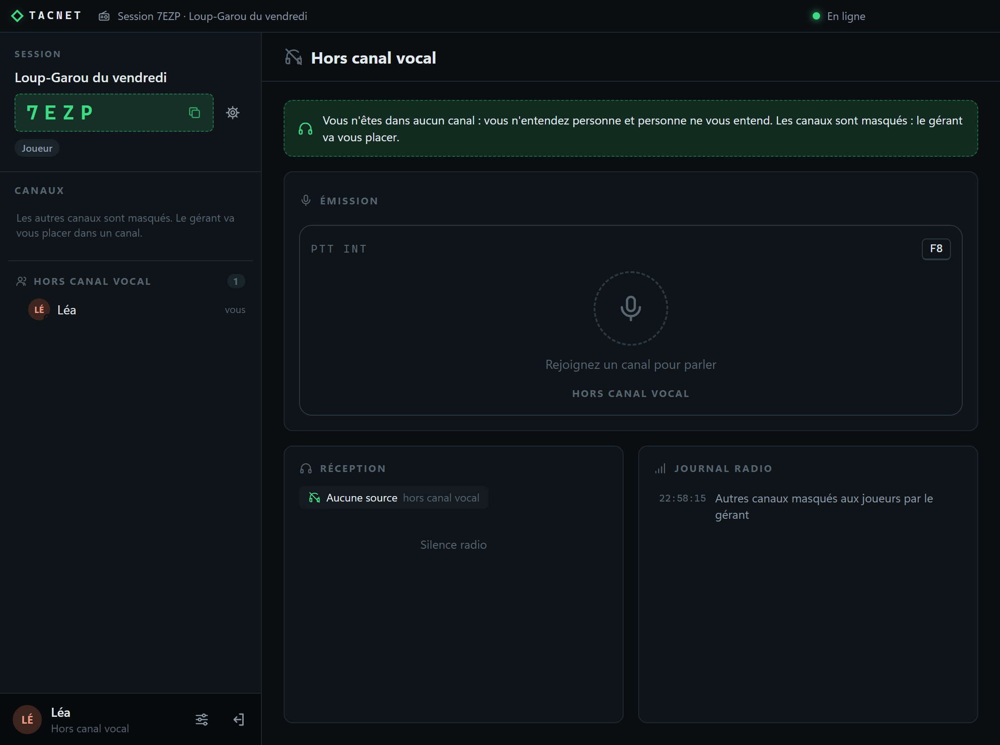
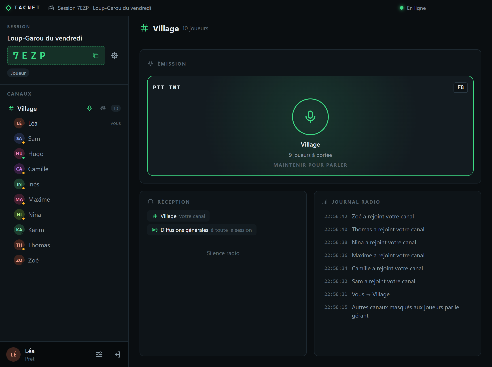

# TACNET

**Communication vocale par sessions : parlez en groupe, canal par canal, comme avec une radio.**

TACNET est une application Windows sans installation. Une personne crée une session et partage un code de 4 caractères ; les autres la rejoignent et choisissent leur canal. Le serveur ne fait que mettre les joueurs en relation : la voix circule directement entre eux.

## Ce que permet TACNET

- **Sessions et canaux** : un code à 4 caractères, des canaux créés par le gérant, des règles d'écoute (« ce canal entend celui-là »).
- **Parler comme à la radio** : Push To Talk vers son canal (Int), vers les canaux reliés (Ext), vers toute la session (Général) ou vers un seul canal. Les touches se règlent et fonctionnent même quand une autre fenêtre, un jeu par exemple, est au premier plan.
- **Rôles** : gérant, adjoint, joueur, auditeur, et des rôles personnalisés réglés option par option.
- **Mode Half-Duplex** : un seul émetteur à la fois vers un canal.
- **Canaux masqués** : chaque joueur ne voit que son propre canal, idéal pour garder le secret des équipes (exemple du Loup-Garou plus bas).
- **Léger** : Windows 64 bits, un seul fichier .exe, sans installation.

## Télécharger

Tout se trouve dans la page [**Releases**](https://github.com/yanks-user/TACNET/releases/latest). Version actuelle : **1.0.0**.

| Fichier | Pour qui | Contenu |
|---|---|---|
| `TACNET_APP.zip` | **Tout le monde** | L'application (`TACNET-1.0.0-portable.exe`), la licence et un guide en français. |
| `TACNET_SERV.zip` | Les plus avancés | Un serveur maison (Docker) avec son guide : domaine, HTTPS, gestion des pseudos. |

Décompressez le zip puis lancez le .exe. L'application n'est pas signée : si Windows affiche « Windows a protégé votre PC », cliquez sur *Informations complémentaires*, puis *Exécuter quand même*.

## Il faut un serveur

TACNET a besoin d'un serveur pour mettre les joueurs en relation. **La méthode conseillée est de le créer gratuitement sur [Render](https://render.com)**, sans machine à laisser allumée et sans compte GitHub :

1. Sur Render : **New +**, **Web Service**, **Public Git Repository**, puis collez `https://github.com/yanks-user/TACNET-SERVER-RENDER`.
2. Réglez *Language* sur **Docker**, laissez *Root Directory* et *Dockerfile Path* vides, et choisissez le plan **Free**.
3. Ajoutez la variable d'environnement `SERVER_PASSWORD` (le mot de passe de votre groupe, 8 caractères minimum), puis lancez le déploiement.
4. Donnez aux joueurs l'adresse `wss://nom-du-service.onrender.com` et le mot de passe.

Le pas-à-pas détaillé est dans le guide (`README.html`) de `TACNET_APP.zip`. Le dépôt [TACNET-SERVER-RENDER](https://github.com/yanks-user/TACNET-SERVER-RENDER) contient ce que Render déploie.

> **Plan gratuit de Render :** le serveur s'endort après 15 minutes sans activité (le réveil prend environ une minute) et ses données, pseudos réservés et sessions gardées, sont effacées à chaque redémarrage. Pour un serveur permanent, choisissez un plan payant de Render, ou le serveur maison de `TACNET_SERV.zip`.

## Captures

| La vue du gérant : canaux, joueurs et règles | Les règles d'écoute : qui entend qui |
|---|---|
|  |  |

| Canaux masqués : ce que voit un joueur | Paramètres de la session : ce que règle le gérant |
|---|---|
|  |  |

## Exemple : le Loup-Garou à 10 joueurs

Les canaux masqués servent à garder un secret. Voici une partie de Loup-Garou en version simple : **3 loups-garous et 7 villageois**, sans les autres rôles. Le narrateur est le **gérant** : il ne joue pas, voit tout et place les joueurs.

**Mise en place**

1. Le narrateur crée la session et deux canaux, **Village** et **Loups**, puis active *Masquer les autres canaux aux joueurs* (Paramètres de la session, Communication).
2. Les 10 joueurs rejoignent avec leur pseudo. Ils arrivent « hors canal vocal » et ne voient personne.
3. Les rôles sont distribués en dehors de TACNET (cartes, messages privés) : seul le narrateur sait qui est loup.

**La nuit : le village dort**

- Le narrateur place les 3 loups dans **Loups** (glisser-déposer du joueur sur le canal, ou clic droit sur le joueur puis *Déplacer vers*). Les loups se voient et se parlent entre eux, et ne voient aucun villageois.
- Les 7 villageois restent **hors canal vocal** : ils n'entendent rien et ne voient personne. C'est leur façon de dormir.

| Un loup voit sa meute, et personne d'autre | Une villageoise endormie ne voit personne |
|---|---|
|  |  |

| Le narrateur voit tout | Le jour, le village se réveille |
|---|---|
|  |  |

**Le jour : le village se réveille**

- Le narrateur place les 10 joueurs dans **Village** : tout le monde s'entend et voit les 10 pseudos, le débat peut commencer.
- Le soir venu, il remet les 3 loups dans **Loups** et les villageois hors canal vocal.

> **Pourquoi pas un canal « Villageois » ?** Un villageois y verrait la liste des 7 villageois, et son journal lui dirait qui est parti. Connaissant les 10 joueurs, il déduirait les loups par élimination. Hors canal vocal, il ne voit rien : il n'y a rien à déduire.

**Bon à savoir**

- Le narrateur doit être lui-même dans un canal pour parler. Son PTT Général est entendu par tous les joueurs placés dans un canal : annoncez « le village s'endort » avant de les mettre hors canal vocal, et le résultat de la nuit une fois le village réveillé.
- Pour écouter les loups sans figurer dans leur canal, activez *Le gérant entend toutes les communications* et restez dans Village.
- Chaque changement de phase demande une dizaine de déplacements. Un adjoint qui ne joue pas peut aider le narrateur : il voit tout, comme lui.

## Licence

Tous droits réservés, sauf ce que permet [LICENCE.txt](LICENCE.txt) : utilisation gratuite, partage de copies non modifiées avec leur licence, mais ni vente ni modification. Les composants tiers gardent leurs propres licences, réunies dans le dossier `licenses` des zips.
