<p align="center"></p>

# TACNET

**Communication vocale par sessions : parlez en groupe, canal par canal, comme avec une radio.**

TACNET est une application Windows. Une personne crée une session et partage un code de 4 caractères ; les autres la rejoignent et choisissent leur canal. Le serveur ne fait que mettre les joueurs en relation : la voix circule directement entre eux.

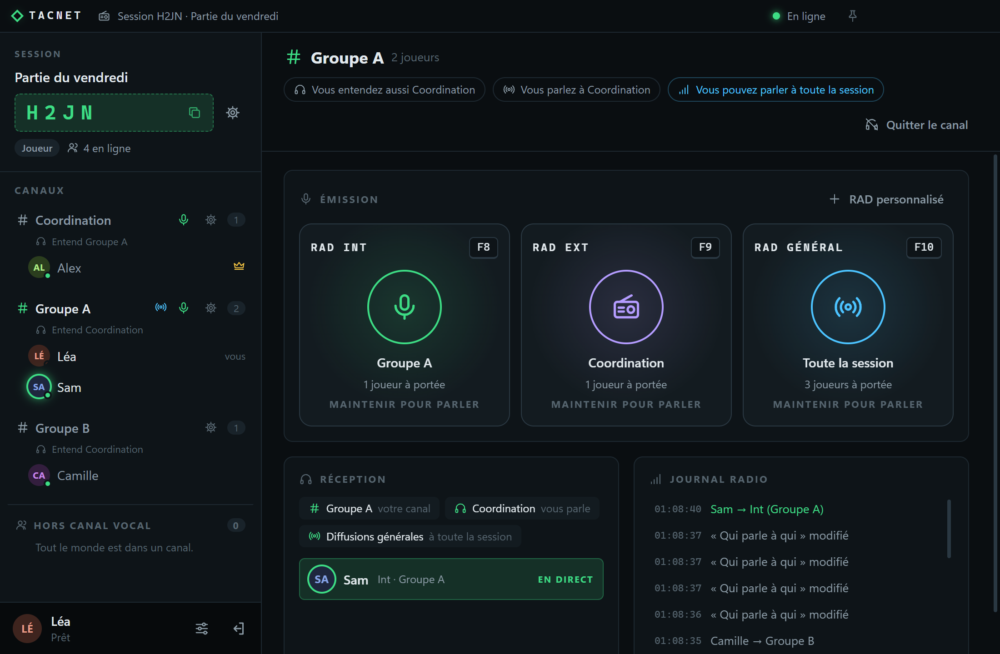

## Ce que permet TACNET

- **Sessions et canaux** : un code à 4 caractères, des canaux créés par le gérant, et un tableau **Qui parle à qui** pour choisir à quels canaux chaque canal parle.
- **Parler comme à la radio** : le **RAD** (radio) vers son canal (Int), vers les canaux reliés (Ext), vers toute la session (Général) ou vers un seul canal. Les touches se règlent et fonctionnent même quand une autre fenêtre, un jeu par exemple, est au premier plan.
- **Rôles** : gérant, adjoint, joueur, auditeur, et des rôles personnalisés réglés option par option.
- **Mode Half-Duplex et RAD prioritaire** : un seul émetteur à la fois vers un canal. Avec l'option **RAD prioritaire**, les canaux que choisit le gérant, le commandement par exemple, coupent aussitôt la parole de celui qui occupe un canal qu'ils visent.
- **Canaux masqués** : chaque joueur ne voit que son propre canal, idéal pour garder le secret des équipes (exemple du Loup-Garou plus bas).
- **Fenêtre épinglable et réductible** : le pin de la barre de titre garde TACNET au-dessus des autres fenêtres, et la fenêtre peut se réduire jusqu'à ne montrer que les canaux et ceux qui y sont.
- **Mises à jour signalées** : un bandeau prévient quand une nouvelle version est publiée, et quand le serveur n'est pas à jour, pour que son hébergeur le sache.
- **Installateur ou portable** : Windows 64 bits, un installateur qui met TACNET à jour tout seul, ou un seul fichier .exe sans installation.

## Télécharger

Tout se trouve dans la page [**Releases**](https://github.com/yanks-user/TACNET/releases/latest). Version actuelle : **1.6.0**.

> **Windows affiche « Windows a protégé votre PC » ?** C'est normal : TACNET n'est pas signé, car un certificat de signature de code est payant. Windows prévient ainsi pour toute application sans certificat. Cliquez sur *Informations complémentaires*, puis *Exécuter quand même*.

| Fichier | Pour qui | Contenu |
|---|---|---|
| `TACNET-Setup-x.y.z.exe` | **Tout le monde (conseillé)** | L'installateur : installe TACNET dans le dossier de votre choix, sans droits d'administrateur, et le met à jour tout seul. |
| `TACNET_APP.zip` | Sans installation | La version portable (`TACNET-1.6.0-portable.exe`), la licence et un guide en français. |
| `TACNET_SERV.zip` | Les plus avancés | Un serveur à lancer avec Node.js sous Windows (un double-clic), avec son guide Docker et Node.js : domaine, HTTPS, gestion des pseudos. |

Installateur : lancez-le. Sa première page propose le dossier d'installation (`C:\Users\<votre nom>\AppData\Local\Programs\TACNET` par défaut, bouton *Parcourir* pour en choisir un autre, hors `C:\Program Files`). Version portable : décompressez le zip puis lancez le .exe.

**Mises à jour.** Depuis la 1.1.0, TACNET regarde au démarrage (puis toutes les 6 heures) si une version plus récente est publiée sur cette page, et l'indique par un bandeau : *Télécharger* ouvre la page de la version, il suffit ensuite de remplacer l'ancien .exe par le nouveau. **Avec l'installateur**, le bouton devient *Mettre à jour* : TACNET télécharge la version, puis *Redémarrer et installer* la met en place et rouvre TACNET. Rien n'est téléchargé ni installé sans votre clic, et seule la version de l'application est transmise (GitHub voit votre adresse IP, comme tout site que vous visitez). Ce réglage se désactive dans *Paramètres > À propos*. Le serveur fait de même dans son journal (`UPDATE_CHECK=off` pour le couper) : si le serveur d'un groupe n'est pas à jour, les joueurs le voient et préviennent celui qui l'héberge. La 1.0.0 n'a pas cette fonction : elle se remplace une fois à la main.

**Installateur ou portable ?** Les réglages de l'application installée (adresse du serveur, touches, audio) sont dans `%APPDATA%\TACNET`, et survivent aux mises à jour, qui gardent aussi le dossier choisi. Pour déplacer TACNET, relancez l'installateur et choisissez un autre dossier : l'ancien emplacement est retiré et vos réglages sont conservés. En venant de la version portable, ressaisissez l'adresse du serveur et vos touches une fois : le mot de passe du serveur, vos pseudos réservés et vos sessions sauvegardées sont repris. Choisissez l'une ou l'autre version. Pour désinstaller : *Paramètres Windows > Applications > TACNET*.

## Il faut un serveur

TACNET a besoin d'un serveur pour mettre les joueurs en relation. Il y a trois façons d'en avoir un, de la plus simple à la plus libre. Dans les trois cas, les joueurs utilisent la même application : une adresse et un mot de passe.

| | [Render](#render) | [Docker](#docker) | [Node.js sous Windows](#nodejs-sous-windows) |
|---|---|---|---|
| **Pour qui** | Personne n'a de machine à laisser allumée | Un NAS, un mini-serveur, un hébergeur (VPS) ou un PC avec Docker | Un PC Windows allumé pendant les parties, sans Docker |
| **Il vous faut** | Un compte Render, gratuit | Docker et un seul fichier `docker-compose.yml` | Node.js et `TACNET_SERV.zip` |
| **Les réglages** | Une variable : le mot de passe | Dans le fichier : mot de passe et port | Dans `config.env` : mot de passe et port |
| **Vos données** | Effacées à chaque redémarrage sur le plan gratuit, sauf avec l'option Upstash | Gardées | Gardées |
| **Chiffrement** | Automatique, sans empreinte | Certificat auto-signé avec empreinte, ou [domaine avec HTTPS](docs/domaine-et-https.md) | Comme Docker |

### Render

**C'est la méthode conseillée pour commencer** : gratuite, sans machine à laisser allumée et sans compte GitHub. Créez le serveur sur [Render](https://render.com) :

1. Sur Render : **New +**, **Web Service**, **Public Git Repository**, puis collez `https://github.com/yanks-user/TACNET-SERVER-RENDER`.
2. Réglez *Language* sur **Docker**, laissez *Root Directory* et *Dockerfile Path* vides, et choisissez le plan **Free**.
3. Ajoutez la variable d'environnement `SERVER_PASSWORD` (le mot de passe de votre groupe, 8 caractères minimum), puis lancez le déploiement.
4. Donnez aux joueurs l'adresse `wss://nom-du-service.onrender.com` et le mot de passe.

Le pas-à-pas détaillé est dans le guide (`README.html`) de `TACNET_APP.zip`. Le dépôt [TACNET-SERVER-RENDER](https://github.com/yanks-user/TACNET-SERVER-RENDER) contient ce que Render déploie, et ce que Docker construit plus bas.

> **Plan gratuit de Render :** le serveur s'endort après 15 minutes sans activité (le réveil prend environ une minute) et ses données, pseudos réservés et sessions gardées, sont effacées à chaque redémarrage, redéploiement et mise en veille. C'est une limite du plan gratuit de Render, pas de TACNET. **Une option gratuite, [Upstash](https://upstash.com), permet de garder ces données** : deux variables à ajouter dans Render, expliquées juste en dessous. Pour un serveur permanent, vous pouvez aussi choisir un plan payant de Render, ou l'une des deux façons ci-dessous (Docker, Node.js), où les données sont gardées.

#### Garder les pseudos et les sessions (facultatif)

Sans cette option, rien ne change. Avec elle, le serveur copie ses pseudos réservés, ses codes de session et ses sessions gardées chez [Upstash](https://upstash.com), un petit service en ligne gratuit (environ 256 Mo et 500 000 commandes par mois d'après Upstash), et les y retrouve après chaque redémarrage, mise à jour ou mise en veille.

1. Sur [upstash.com](https://upstash.com), créez un compte gratuit, puis une base **Redis**. Choisissez une région d'Europe, par exemple Frankfurt, proche de votre service Render.
2. Sur la page de la base, dans la partie **REST API**, copiez `UPSTASH_REDIS_REST_URL` et `UPSTASH_REDIS_REST_TOKEN`.
3. Dans Render, onglet **Environment** de votre service, ajoutez ces deux variables, avec les mêmes noms, puis enregistrez. Render relance le serveur.
4. Vérifiez : l'onglet **Logs** affiche « Stockage durable Upstash : actif ».

À savoir : le serveur doit être en version 1.3.0 ou plus récente (*Manual Deploy*, puis *Deploy latest commit*). Le jeton (`UPSTASH_REDIS_REST_TOKEN`) est un mot de passe : ne le partagez pas. Prévoyez une base par serveur, ou un `UPSTASH_KEY_PREFIX` différent pour chacun. Seuls les pseudos réservés, les codes de session et les sessions gardées sont conservés : après un redémarrage, les joueurs connectés se reconnectent. Upstash est un service tiers : il reçoit les pseudos, les noms de session et des empreintes de jetons, jamais le mot de passe du serveur ni la voix.

### Docker

Pour un NAS, un mini-serveur, un hébergeur (VPS) ou un PC : tout ce qui fait tourner Docker Compose. **Il n'y a rien à télécharger** : Docker construit le serveur lui-même depuis le [dépôt public](https://github.com/yanks-user/TACNET-SERVER-RENDER), comme Render. Il suffit de créer un dossier et un seul fichier, en quatre étapes.

1. **Installez [Docker](https://docs.docker.com/get-docker/)** sur la machine qui restera allumée : Docker Desktop sous Windows ou Mac, Docker Engine avec Compose sous Linux. Un NAS le propose souvent parmi ses applications.
2. **Créez un dossier pour le serveur.** Ouvrez un terminal (une connexion SSH sur un NAS ou un hébergeur, par exemple `ssh utilisateur@adresse-du-serveur` ; PowerShell sous Windows), créez le dossier, puis placez-vous dedans. Le nom est libre :

   ```
   mkdir tacnet-serveur
   cd tacnet-serveur
   ```

3. **Créez et réglez le fichier.** Cette commande crée `docker-compose.yml` et l'ouvre dans l'éditeur nano :

   ```
   nano docker-compose.yml
   ```

   Collez le contenu ci-dessous (clic droit, ou Maj+Inser, dans la plupart des terminaux) et remplacez le mot de passe (8 caractères minimum). Enregistrez avec **Ctrl+O** puis **Entrée**, et quittez avec **Ctrl+X**. Sous Windows, `notepad docker-compose.yml` ouvre le Bloc-notes à la place.

   ```yaml
   # Serveur TACNET : le seul fichier à créer
   services:
     tacnet:
       # Construit depuis le dépôt public de TACNET, comme Render
       build: https://github.com/yanks-user/TACNET-SERVER-RENDER.git
       restart: unless-stopped
       init: true
       stop_grace_period: 15s
       ports:
         # 1er nombre = port des joueurs ("9000:8080" pour le 9000)
         - "8080:8080"
       environment:
         # Mot de passe demandé aux joueurs, 8 caractères minimum
         SERVER_PASSWORD: "changez-moi-svp"
         # Derrière un reverse proxy (HTTPS) : retirez les deux #
         # TLS: "off"
         # TRUST_PROXY: "true"
       volumes:
         # Pseudos, codes, sessions et certificat : survivent aux mises à jour
         - tacnet-data:/data
       read_only: true
       tmpfs:
         - /tmp
       cap_drop:
         - ALL
       security_opt:
         - no-new-privileges:true
   volumes:
     tacnet-data:
   ```

4. **Créez et lancez le serveur**, toujours dans ce dossier :

   ```
   docker compose up -d --build
   ```

   `--build` construit le serveur (une à deux minutes la première fois) et `-d` le lance en arrière-plan : vous pouvez fermer le terminal.

Il reste à donner l'accès aux joueurs :

1. Relevez l'empreinte du certificat avec `docker compose logs tacnet` (ligne « Empreinte du certificat »).
2. Donnez aux joueurs l'adresse `wss://ADRESSE-DU-SERVEUR:8080`, le mot de passe et l'empreinte.
3. Ouvrez le port 8080 (ou celui que vous avez choisi en changeant le premier nombre de `ports`), et redirigez-le depuis votre box pour jouer hors de votre réseau.

Pour mettre à jour : `docker compose build --no-cache`, puis `docker compose up -d`. Pseudos, sessions et certificat restent dans le volume Docker. Le fichier contient le mot de passe en clair : ne le partagez pas.

**Un nom de domaine avec HTTPS** (une adresse simple, et plus d'empreinte à donner) : suivez le [guide Domaine et HTTPS](docs/domaine-et-https.md), qui ajoute Caddy à ce même fichier.

### Node.js sous Windows

Sans Docker, sur un PC Windows allumé pendant les parties :

1. Installez la version LTS de [Node.js](https://nodejs.org).
2. Décompressez `TACNET_SERV.zip` (page des [Releases](https://github.com/yanks-user/TACNET/releases/latest)) où vous voulez.
3. Double-cliquez sur `demarrer-serveur.cmd` : il installe les composants du serveur, crée `config.env` et l'ouvre dans le Bloc-notes. Remplissez `SERVER_PASSWORD` (8 caractères minimum), enregistrez, fermez.
4. Double-cliquez de nouveau sur `demarrer-serveur.cmd`, autorisez Node.js dans le pare-feu Windows s'il le demande, et **laissez la fenêtre ouverte** pendant les parties : l'empreinte à donner aux joueurs s'y affiche.
5. Donnez aux joueurs l'adresse `wss://ADRESSE-DU-SERVEUR:8080`, le mot de passe et l'empreinte, et ouvrez ou redirigez le port 8080 comme pour Docker.

**Un nom de domaine avec HTTPS** : suivez le [guide Domaine et HTTPS](docs/domaine-et-https.md). Le guide (`README.html`) de `TACNET_SERV.zip` détaille Docker et Node.js : mise à jour, sauvegarde, autre port, pseudos bloqués.

## Les services tiers

TACNET s'appuie sur quelques services extérieurs. Le schéma montre le rôle de chacun, le tableau ce qu'il voit.

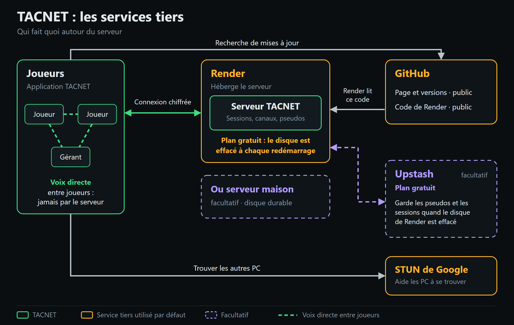

| Service | À quoi il sert | Obligatoire ? | Ce qu'il voit | Coût |
|---|---|---|---|---|
| **GitHub** | Héberge cette page, les versions de TACNET et le code du serveur que Render ou Docker construisent. | Pour télécharger TACNET et créer le serveur sur Render ou Docker. La recherche de mises à jour se désactive. | Votre adresse IP et la version de l'application, comme tout site que vous visitez. | Gratuit |
| **Render** | Héberge le serveur TACNET, qui met les joueurs en relation. | Non : Docker ou Node.js conviennent aussi. | Les échanges avec le serveur : Render déchiffre la connexion, il voit donc ce qui s'y échange (pseudos, sessions, et le mot de passe du serveur à la connexion). Jamais la voix. | Plan gratuit : le disque est effacé à chaque redémarrage |
| **Upstash** | Garde les pseudos, les codes de session et les sessions quand le disque de Render est effacé. | Non, facultatif. | Les pseudos, les noms de session et des empreintes de jetons. Jamais le mot de passe du serveur ni la voix. | Plan gratuit |
| **STUN de Google** | Aide les PC à se trouver pour que la voix passe en direct. | Par défaut. L'adresse se change dans le fichier de configuration. | Votre adresse IP et votre port, quand vous rejoignez une session. Jamais la voix. | Gratuit |
| **Votre propre serveur** | Remplace Render, avec un disque durable : Docker (NAS, mini-serveur, hébergeur) ou Node.js sous Windows. | Non, facultatif. | Rien d'extérieur : c'est vous qui l'hébergez. | À votre charge |

La voix ne passe par aucun de ces services : elle circule directement entre les joueurs. Un relais TURN peut s'ajouter en option pour les réseaux qui bloquent les connexions directes (voir le guide).

## Captures

| La vue du gérant : canaux, joueurs et règles | Qui parle à qui : à quels canaux chaque canal parle |
|---|---|
| 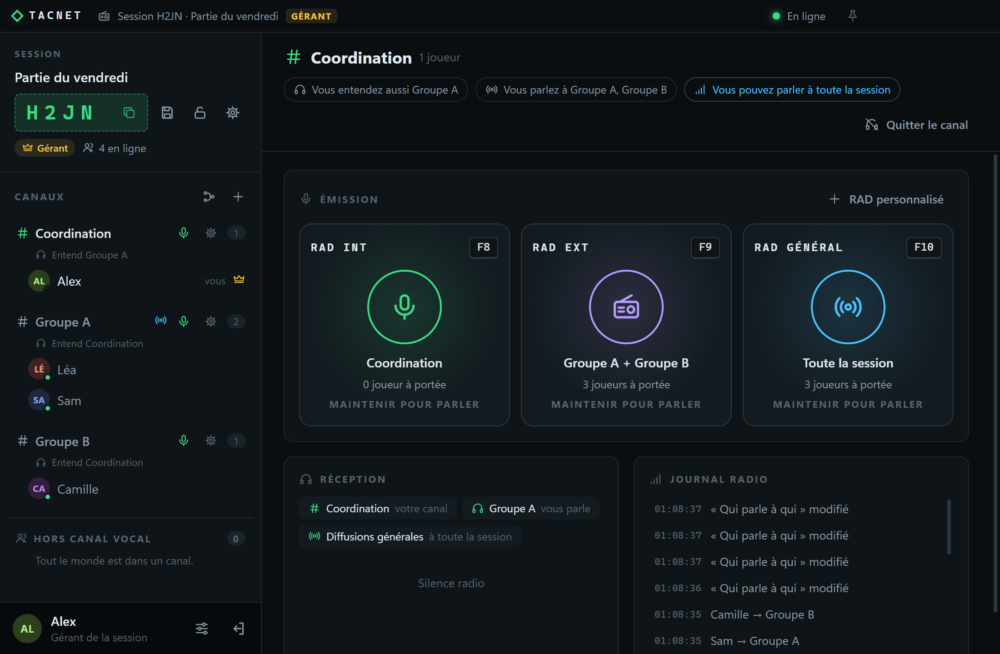 | 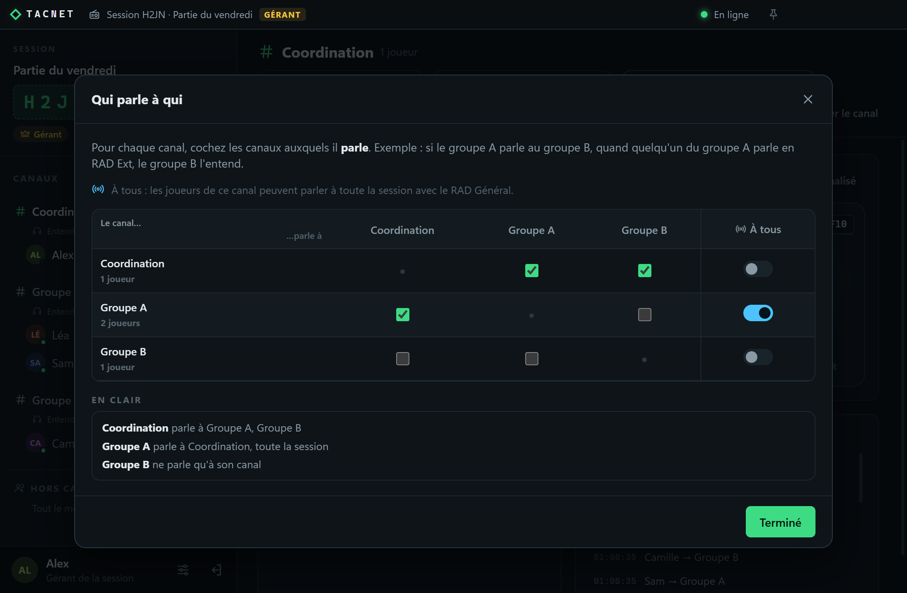 |

| Canaux masqués : ce que voit un joueur | Paramètres de la session : ce que règle le gérant |
|---|---|
| 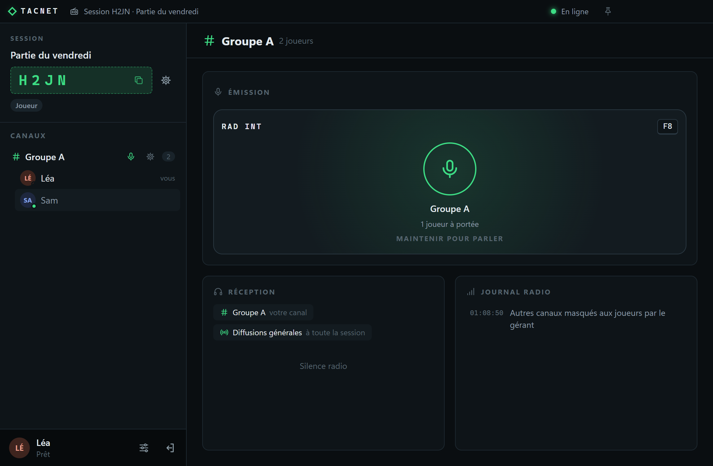 | 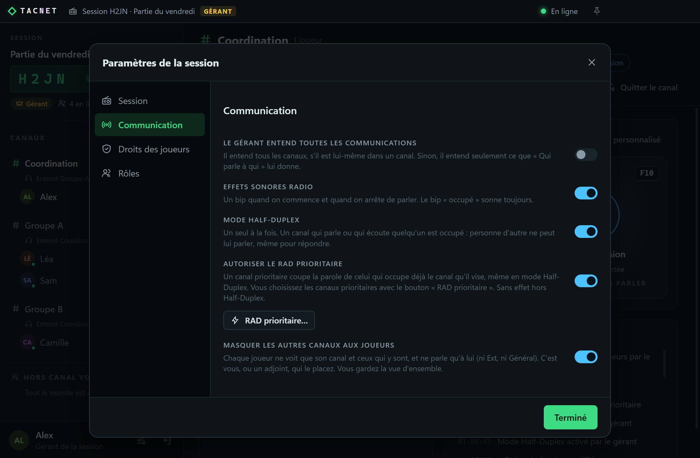 |

| RAD prioritaire : le gérant choisit les canaux prioritaires | Ce que voit celui dont la parole est coupée |
|---|---|
| 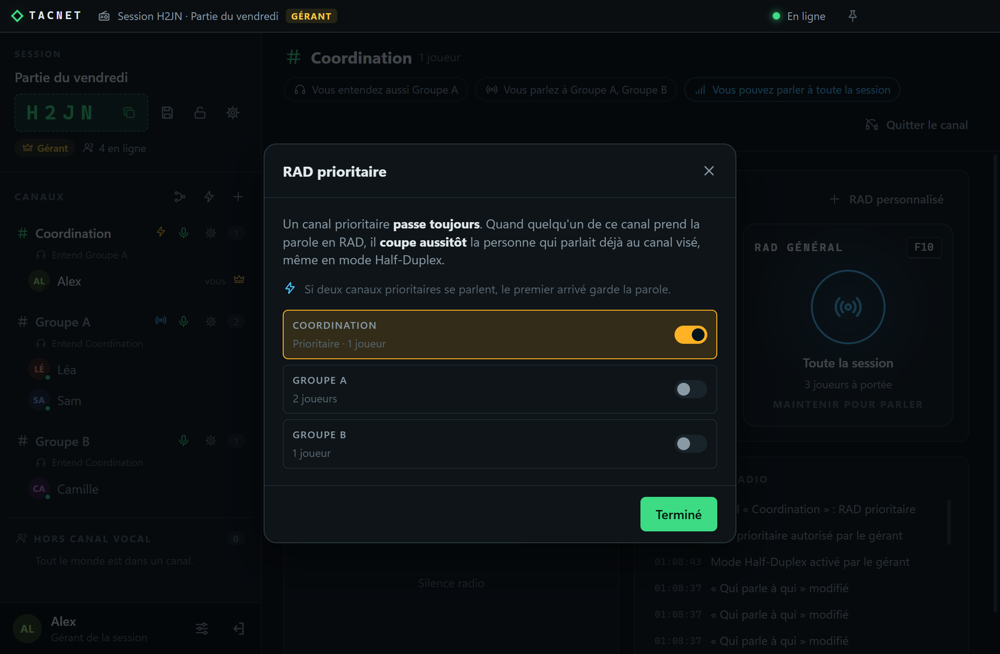 | 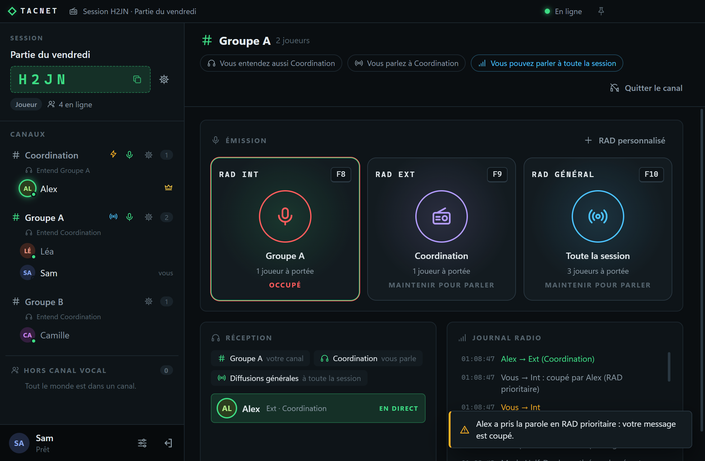 |

## Exemple : le Loup-Garou à 10 joueurs

Les canaux masqués servent à garder un secret. Exemple avec une partie de Loup-Garou à 10 joueurs : **3 loups-garous, 1 voyante, 1 sorcière et 5 villageois** (les autres rôles se gèrent de la même façon).

**Le principe** : TACNET ne remplace pas votre vocal habituel, il le complète. Le jour, tout le monde débat sur Discord (ou un autre vocal). La nuit, tout le monde coupe son micro sur Discord, et le narrateur utilise TACNET pour parler aux rôles de nuit, un par un. Chacun garde le même canal toute la partie : **personne n'a jamais à changer de canal**.

**Mise en place, une seule fois**

1. Le narrateur est le **gérant**. Il crée la session, puis active *Masquer les autres canaux aux joueurs* et *Le gérant entend toutes les communications* (Paramètres de la session, Communication). Il le fait **avant l'arrivée des joueurs** : sinon leurs premiers écrans montrent encore tous les canaux.
2. Il crée un canal par rôle de nuit, **Loups**, **Voyante** et **Sorcière**, plus un canal **Narrateur** pour lui (il doit être dans un canal pour parler et pour écouter).
3. Les 10 joueurs rejoignent la session : ils arrivent « hors canal vocal ». Le narrateur place les 3 loups dans Loups, la voyante dans Voyante et la sorcière dans Sorcière (glisser-déposer du joueur sur le canal, ou clic droit sur le joueur puis *Déplacer vers*), puis entre dans son canal. **Les 5 villageois ne bougent pas** : ils restent hors canal vocal, dans la session comme tout le monde, pour que leur présence ne trahisse aucun rôle.

**Une nuit**

1. Sur Discord, le narrateur annonce « Le village s'endort » : tout le monde coupe son micro.
2. Sur TACNET, il appelle les rôles l'un après l'autre : « Les loups-garous se réveillent ». Les loups se concertent entre eux en RAD Int et le narrateur les entend, ils désignent leur victime. Puis « La voyante se réveille » : elle répond, seul le narrateur l'entend. Puis la sorcière.
3. Au matin, tout le monde rouvre son micro sur Discord et le narrateur annonce la victime.

| Le narrateur voit tout et appelle un rôle à la fois | Un loup voit ses complices, et le narrateur qui lui parle |
|---|---|
| 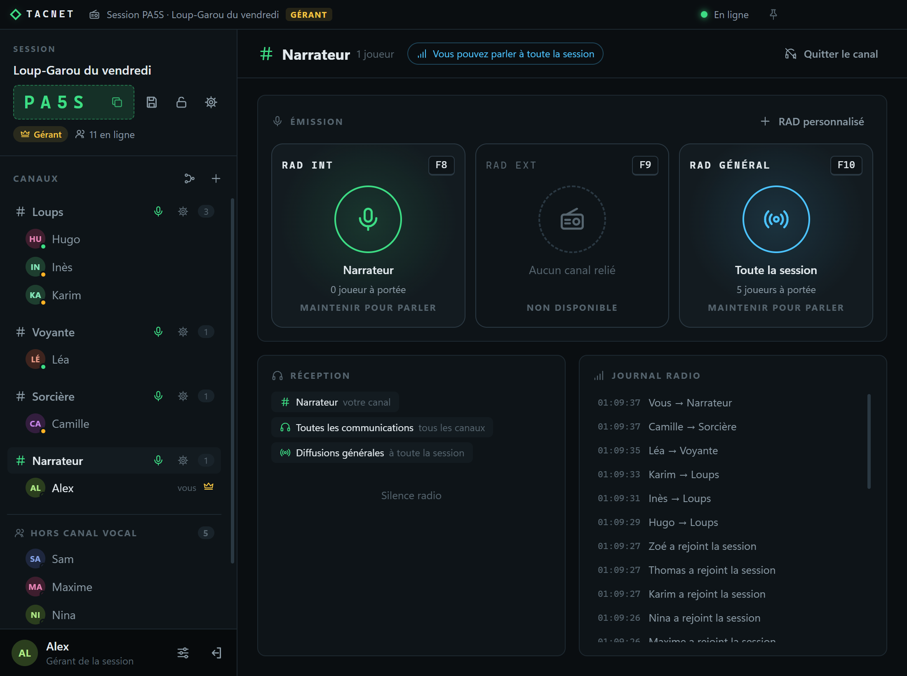 | 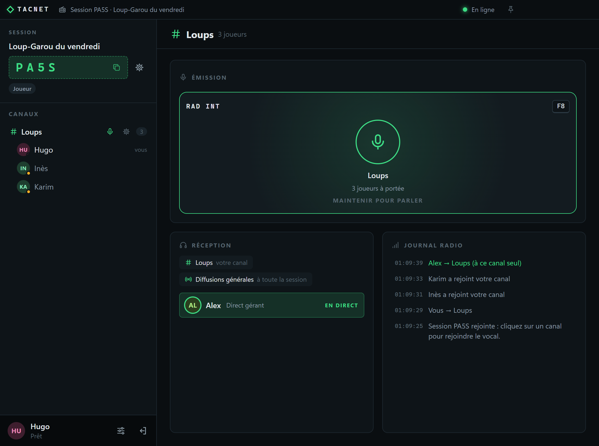 |

| La voyante est seule dans son canal | Un villageois ne voit personne |
|---|---|
| 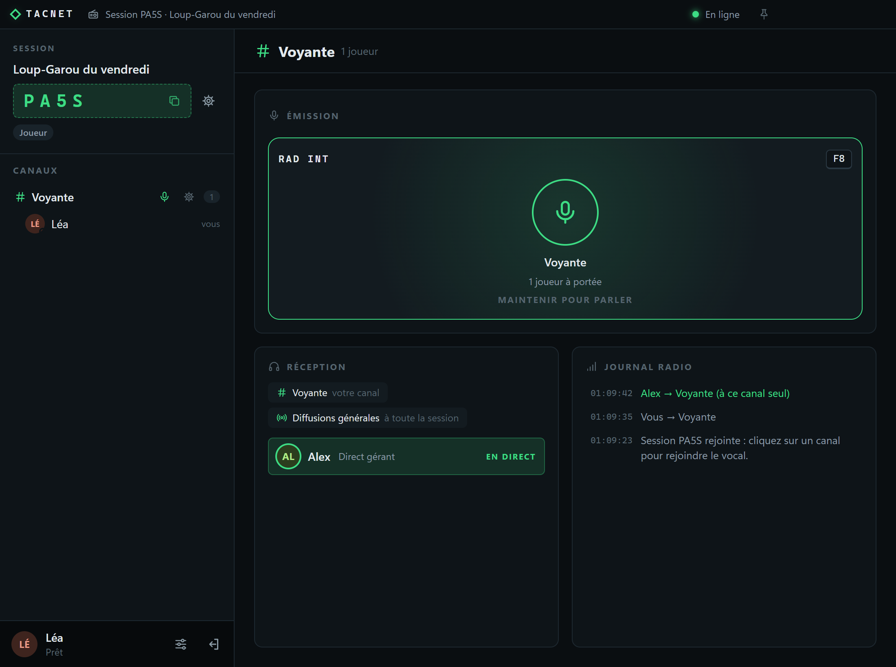 | 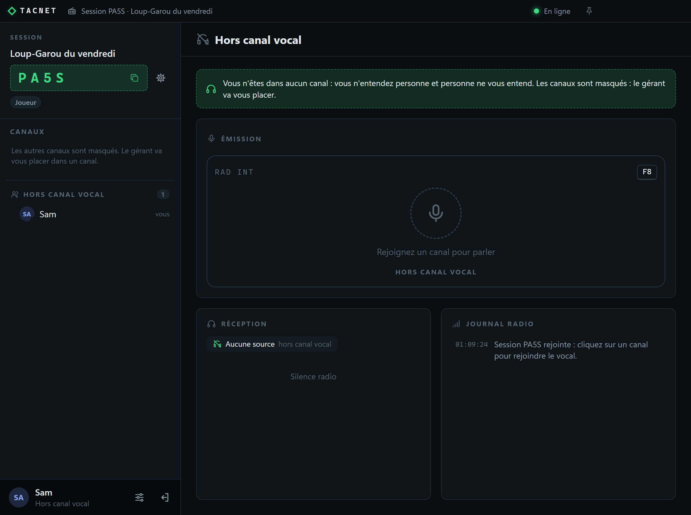 |

**Ce que chacun voit** : un loup ne voit que ses complices ; la voyante et la sorcière ne voient qu'elles-mêmes ; un villageois ne voit personne et n'entend rien (l'application lui dit « le gérant va vous placer » : c'est normal, il n'a pas besoin de canal) ; seul le narrateur voit tout. Aucun joueur ne peut changer de canal, ni savoir qu'un autre canal existe.

> **Pourquoi pas un canal « Villageois » ?** Les villageois y verraient la liste des 5 autres villageois et en déduiraient qui a un rôle de nuit. Hors canal vocal, ils ne voient rien.

**Bon à savoir**

- Pour un rôle de nuit de plus (Cupidon, par exemple), ajoutez un canal et placez-y le joueur.
- Le RAD Général du narrateur est entendu par tous les joueurs placés dans un canal, mais pas par les villageois hors canal vocal.
- Utilisez un casque : sinon la voix jouée par les haut-parleurs peut repartir dans le micro d'un autre vocal.

## Licence

Tous droits réservés, sauf ce que permet [LICENCE.txt](LICENCE.txt) : utilisation gratuite, partage de copies non modifiées avec leur licence, mais ni vente ni modification. Les composants tiers gardent leurs propres licences, réunies dans le dossier `licenses` des zips.
