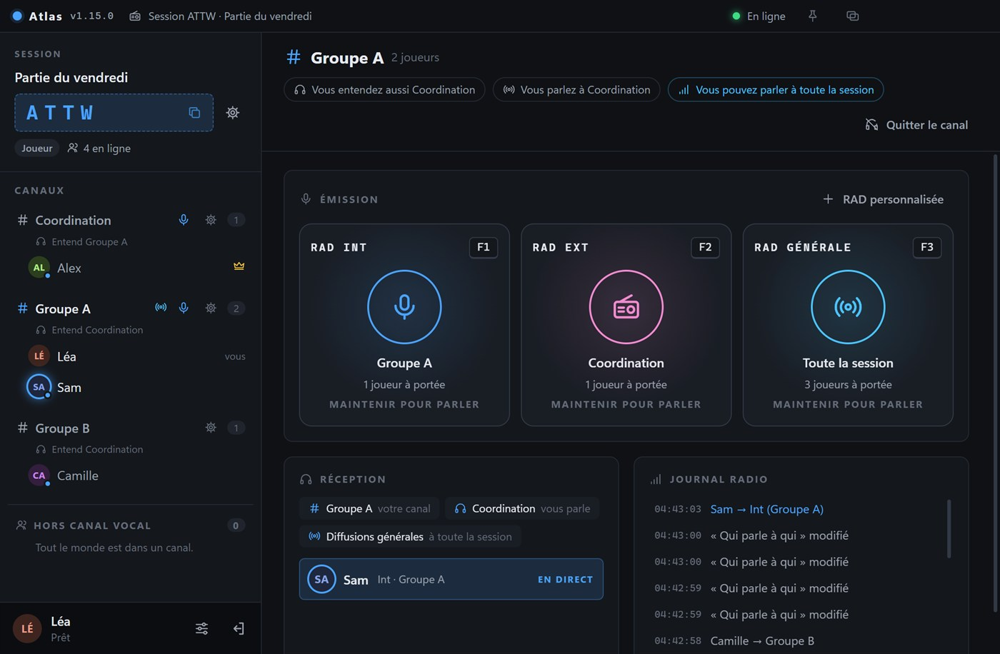
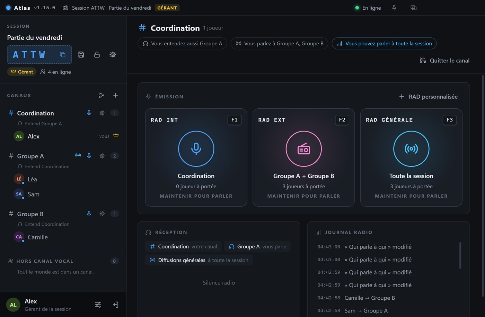
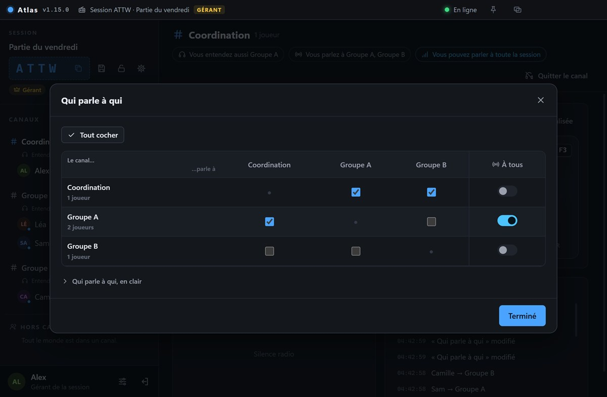
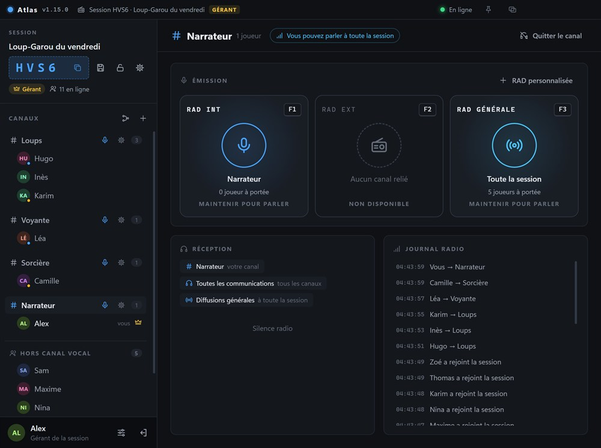
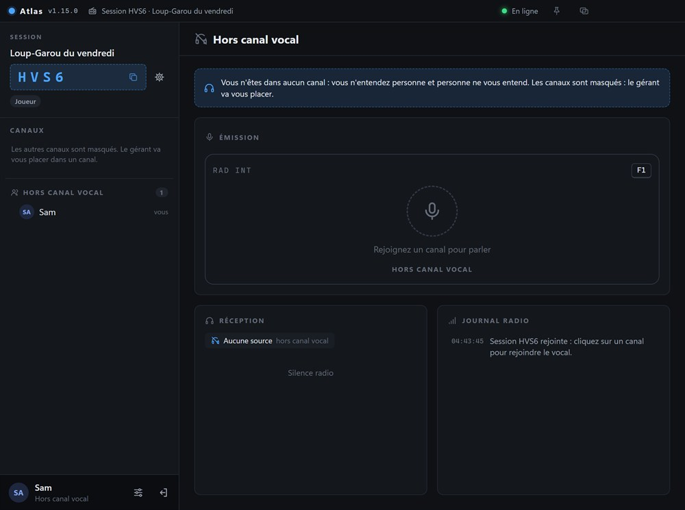

<p align="center"></p>

# Atlas

**Communication vocale par sessions : parlez en groupe, canal par canal, comme avec une radio.**

Une application Windows pour les parties de jeu en équipe, les soirées, les réunions. Une personne crée une session et partage un code de 4 caractères ; les autres la rejoignent et choisissent leur canal. Le serveur ne fait que mettre les joueurs en relation : la voix circule directement entre eux.



## L'essentiel

- **Sessions et canaux** : un code à 4 caractères, des canaux créés par le gérant, et un tableau **Qui parle à qui**.
- **Parler comme à la radio** : la **RAD** vers son canal, les canaux reliés, toute la session ou un seul canal. Les touches marchent même quand un jeu est au premier plan.
- **Half-Duplex et RAD prioritaire** : un seul émetteur à la fois vers un canal, et des canaux prioritaires qui peuvent couper la parole.
- **Overlays en jeu** : maintenez une touche, tournez la molette, relâchez : vous changez de canal sans quitter le jeu. Un second overlay choisit la RAD à qui parler, et une touche répond à la dernière personne entendue.
- **Canaux masqués** : chacun ne voit que son canal, pour garder un secret (exemple plus bas).
- **À votre façon** : image de profil, rôles, bips et effet radio personnels, fenêtre épinglable et réductible.

## Télécharger

Bientôt sur le MicrosoftStore.

## Il faut un serveur

Atlas a besoin d'un serveur pour mettre les joueurs en relation.

Pour avoir le vôtre, trois façons, de la plus simple à la plus libre. Dans les trois cas, les joueurs utilisent la même application : une adresse et un mot de passe.

| | [Render](#render) | [Docker](#docker) | |
|---|---|---|---|
| **Pour qui** | Personne n'a de machine à laisser allumée | Un NAS, un mini-serveur, un VPS ou un PC avec Docker |
| **Il vous faut** | Un compte Render, gratuit | Docker et un fichier `docker-compose.yml` |
| **Vos données** | Effacées à chaque redémarrage (plan gratuit) | Gardées |
| **Chiffrement** | Automatique | Certificat auto-signé, ou [domaine avec HTTPS](docs/domaine-et-https.md) |

### Render

**Conseillé pour commencer** : gratuit, sans machine à laisser allumée et sans compte GitHub.

1. Sur [Render](https://render.com) : **New +**, **Web Service**, **Public Git Repository**, puis collez `https://github.com/yanks-user/Atlas-Server-Render`.
2. Réglez *Language* sur **Docker**, choisissez le plan **Free**, et laissez le reste vide.
3. Ajoutez la variable d'environnement `SERVER_PASSWORD` (8 caractères minimum), puis lancez le déploiement.
4. Donnez aux joueurs l'adresse `wss://nom-du-service.onrender.com` et le mot de passe.

> **Plan gratuit** : le serveur s'endort après 15 minutes (le réveil prend environ une minute) et ses pseudos et sessions sont effacés à chaque redémarrage. L'option gratuite **Upstash** les garde : [voir comment](docs/upstash.md). Le service gratuit **UptimeRobot** peut aussi l'empêcher de s'endormir, en l'appelant toutes les 10 minutes : [voir comment](docs/uptimerobot.md). [Le pas-à-pas détaillé](docs/render.md) : vérifier, mettre à jour, changer le mot de passe.

### Docker

Rien à télécharger : Docker construit le serveur depuis le [dépôt public](https://github.com/yanks-user/Atlas-SERVER-RENDER), comme Render. Quatre étapes.

**1. Installez [Docker](https://docs.docker.com/get-docker/)** : Docker Desktop sous Windows ou Mac, Docker Engine avec Compose sous Linux (un NAS le propose souvent).

**2. Créez un dossier pour le serveur** dans un terminal (SSH sur un NAS ou un hébergeur, PowerShell sous Windows) :

```
mkdir atlas-serveur
cd atlas-serveur
```

**3. Créez et réglez le fichier.** Cette commande crée `docker-compose.yml` et l'ouvre dans nano (sous Windows, `notepad docker-compose.yml`) :

```
nano docker-compose.yml
```

Collez le contenu ci-dessous et remplacez le mot de passe (8 caractères minimum). Enregistrez avec **Ctrl+O** puis **Entrée**, et quittez avec **Ctrl+X**.

```yaml
# Serveur Atlas : le seul fichier à créer
#
# Pour mettre à jour le serveur proprement (deux commandes, dans le dossier de ce fichier) :
#   docker compose build --no-cache
#   docker compose up -d
services:
  atlas:
    # Construit depuis le dépôt public d'Atlas, comme Render
    build: https://github.com/yanks-user/Atlas-SERVER-RENDER.git
    restart: unless-stopped
    init: true
    stop_grace_period: 15s
    ports:
      # 1er nombre = port des joueurs ("9000:8080" pour le 9000)
      - "8080:8080"
    environment:
      # Mot de passe demandé aux joueurs, 8 caractères minimum
      SERVER_PASSWORD: "changez-moi-svp"
      # Derrière un reverse proxy (HTTPS) : retirez les deux #
      # TLS: "off"
      # TRUST_PROXY: "true"
    volumes:
      # Pseudos, codes, sessions et certificat : survivent aux mises à jour
      - atlas-data:/data
    read_only: true
    tmpfs:
      - /tmp
    cap_drop:
      - ALL
    security_opt:
      - no-new-privileges:true
volumes:
  atlas-data:
```

**4. Créez et lancez le serveur**, toujours dans ce dossier :

```
docker compose up -d --build
```

La première fois, la construction prend une à deux minutes ; `-d` lance ensuite le serveur en arrière-plan.

Il reste à donner l'accès aux joueurs :

1. Relevez l'empreinte du certificat avec `docker compose logs atlas` (ligne « Empreinte du certificat »).
2. Donnez-leur l'adresse `wss://ADRESSE-DU-SERVEUR:8080`, le mot de passe et l'empreinte.
3. Ouvrez le port 8080 (ou celui choisi dans `ports`), et redirigez-le depuis votre box pour jouer hors de votre réseau.

**Pour mettre à jour**, deux commandes dans le dossier du serveur (elles sont aussi en commentaire dans le fichier) :

```
docker compose build --no-cache
docker compose up -d
```

Pas de `docker compose pull` : le serveur est construit depuis GitHub, il n'y a pas d'image à télécharger. Pseudos, sessions et certificat restent dans le volume Docker.

**Un nom de domaine avec HTTPS** (une adresse simple, et plus d'empreinte à donner) : suivez le [guide Domaine et HTTPS](docs/domaine-et-https.md). Il ajoute Caddy à ce même fichier, mais Nginx, Traefik ou tout autre reverse proxy convient aussi.

## Les services tiers

UpStash pour le stockage et UpTimeRobot pour ne pas que le serveur Render ne se mette en veille.

## Captures

| La vue du gérant | Qui parle à qui |
|---|---|
|  |  |

## Exemple : le Loup-Garou à 10 joueurs

Les canaux masqués servent à garder un secret. Le narrateur est le **gérant** : il crée les canaux **Loups**, **Voyante**, **Sorcière** et **Narrateur**, active *Masquer les autres canaux aux joueurs* **avant l'arrivée des joueurs**, puis place les 3 loups, la voyante et la sorcière dans leur canal. Les 5 villageois restent hors canal vocal.

La nuit, tout le monde coupe son micro sur Discord et le narrateur appelle les rôles un par un sur Atlas. Chacun garde son canal toute la partie, ne voit que ses complices et n'entend que le narrateur.

| Le narrateur voit tout | Un villageois ne voit personne |
|---|---|
|  |  |
