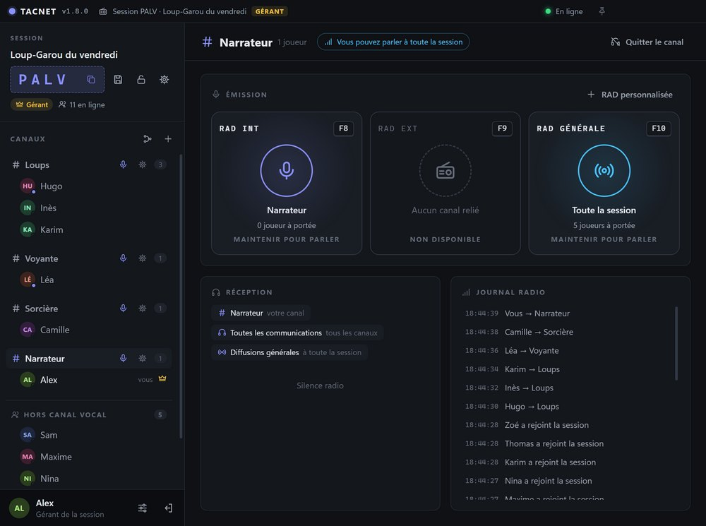
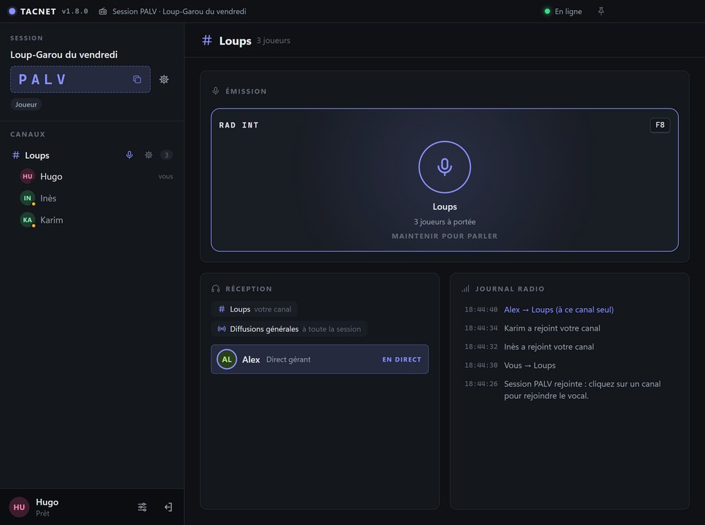
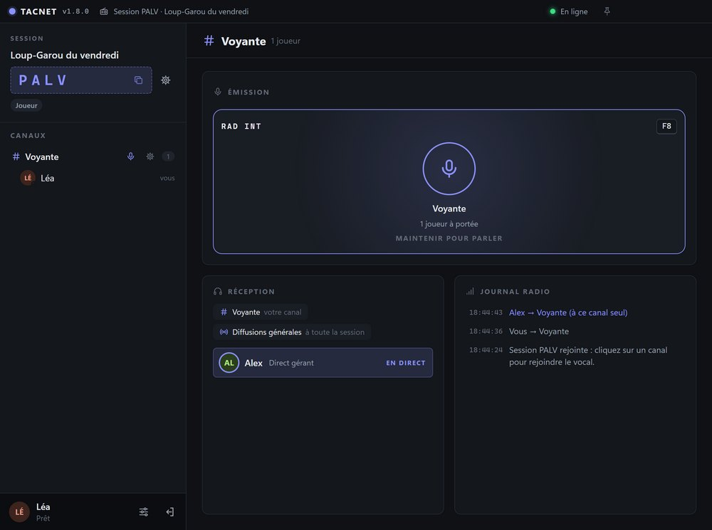
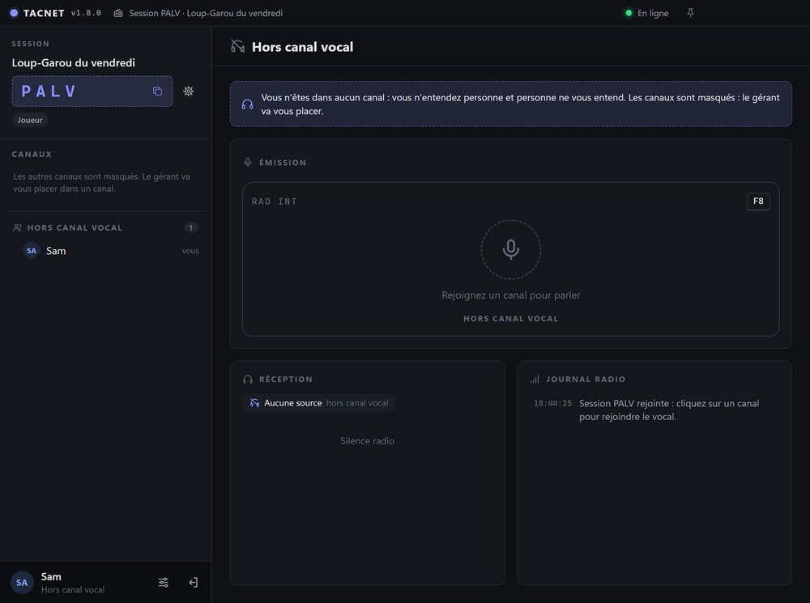

# Exemple : le Loup-Garou à 10 joueurs

[← Retour à la page TACNET](../README.md#exemple--le-loup-garou-à-10-joueurs)

Les canaux masqués servent à garder un secret. Exemple avec une partie de Loup-Garou à 10 joueurs : **3 loups-garous, 1 voyante, 1 sorcière et 5 villageois** (les autres rôles se gèrent de la même façon).

**Le principe** : TACNET ne remplace pas votre vocal habituel, il le complète. Le jour, tout le monde débat sur Discord (ou un autre vocal). La nuit, tout le monde coupe son micro sur Discord, et le narrateur utilise TACNET pour parler aux rôles de nuit, un par un. Chacun garde le même canal toute la partie : **personne n'a jamais à changer de canal**.

## Mise en place, une seule fois

1. Le narrateur est le **gérant**. Il crée la session, puis active *Masquer les autres canaux aux joueurs* et *Le gérant entend toutes les communications* (Paramètres de la session, Communication). Il le fait **avant l'arrivée des joueurs** : sinon leurs premiers écrans montrent encore tous les canaux.
2. Il crée un canal par rôle de nuit, **Loups**, **Voyante** et **Sorcière**, plus un canal **Narrateur** pour lui (il doit être dans un canal pour parler et pour écouter).
3. Les 10 joueurs rejoignent la session : ils arrivent « hors canal vocal ». Le narrateur les place :
   - les 3 loups dans Loups, la voyante dans Voyante et la sorcière dans Sorcière (glisser-déposer du joueur sur le canal, ou clic droit sur le joueur puis *Déplacer vers*) ;
   - lui-même dans son canal.

   **Les 5 villageois ne bougent pas** : ils restent hors canal vocal, dans la session comme tout le monde, pour que leur présence ne trahisse aucun rôle.

## Une nuit

1. Sur Discord, le narrateur annonce « Le village s'endort » : tout le monde coupe son micro.
2. Sur TACNET, il appelle les rôles l'un après l'autre : « Les loups-garous se réveillent ». Les loups se concertent entre eux en RAD Int et le narrateur les entend, ils désignent leur victime. Puis « La voyante se réveille » : elle répond, seul le narrateur l'entend. Puis la sorcière.
3. Au matin, tout le monde rouvre son micro sur Discord et le narrateur annonce la victime.

| Le narrateur voit tout et appelle un rôle à la fois | Un loup voit ses complices, et le narrateur qui lui parle |
|---|---|
|  |  |

| La voyante est seule dans son canal | Un villageois ne voit personne |
|---|---|
|  |  |

**Ce que chacun voit** : un loup ne voit que ses complices ; la voyante et la sorcière ne voient qu'elles-mêmes ; un villageois ne voit personne et n'entend rien (l'application lui dit « le gérant va vous placer » : c'est normal, il n'a pas besoin de canal) ; seul le narrateur voit tout. Aucun joueur ne peut changer de canal, ni savoir qu'un autre canal existe.

> **Pourquoi pas un canal « Villageois » ?** Les villageois y verraient la liste des 5 autres villageois et en déduiraient qui a un rôle de nuit. Hors canal vocal, ils ne voient rien.

## Bon à savoir

- Pour un rôle de nuit de plus (Cupidon, par exemple), ajoutez un canal et placez-y le joueur.
- La RAD Générale du narrateur est entendue par tous les joueurs placés dans un canal, mais pas par les villageois hors canal vocal.
- Utilisez un casque : sinon la voix jouée par les haut-parleurs peut repartir dans le micro d'un autre vocal.
