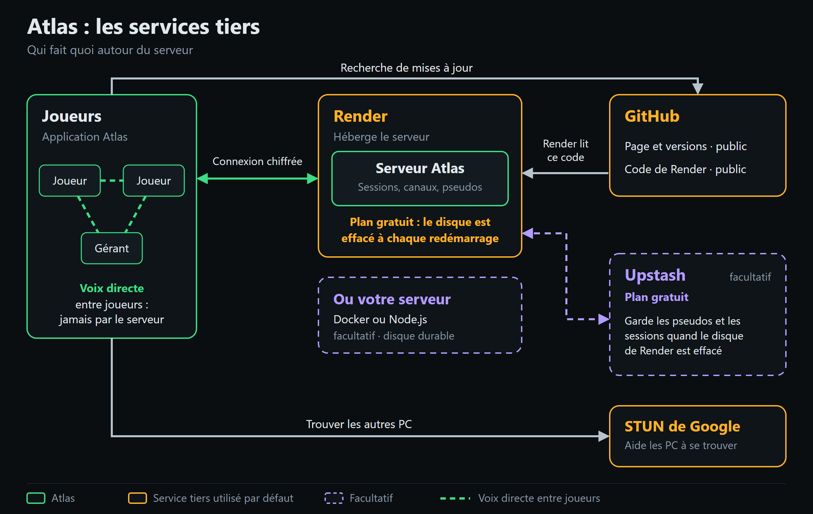

# Les services tiers

[← Retour à la page Atlas](../README.md#les-services-tiers)

Atlas s'appuie sur quelques services extérieurs. Le schéma montre le rôle de chacun, le tableau ce qu'il voit.

| Service | À quoi il sert | Obligatoire ? | Ce qu'il voit | Coût |
|---|---|---|---|---|
| **GitHub** | Héberge la page du projet, les versions d'Atlas et le code du serveur que Render ou Docker construisent. | Pour télécharger Atlas et créer le serveur sur Render ou Docker. La recherche de mises à jour se désactive. | Votre adresse IP et la version de l'application, comme tout site que vous visitez. | Gratuit |
| **Render** | Héberge le serveur Atlas, qui met les joueurs en relation. | Non : Docker ou Node.js conviennent aussi. | Les échanges avec le serveur : Render déchiffre la connexion, il voit donc ce qui s'y échange (pseudos, sessions, et le mot de passe du serveur à la connexion). Jamais la voix. | Plan gratuit : le disque est effacé à chaque redémarrage |
| **Upstash** | Garde les pseudos, les codes de session et les sessions quand le disque de Render est effacé. | Non, facultatif. | Les pseudos, les noms de session et des empreintes de jetons. Jamais le mot de passe du serveur ni la voix. | Plan gratuit |
| **STUN de Google** | Aide les PC à se trouver pour que la voix passe en direct. | Par défaut. L'adresse se change dans le fichier de configuration. | Votre adresse IP et votre port, quand vous rejoignez une session. Jamais la voix. | Gratuit |
| **Votre propre serveur** | Remplace Render, avec un disque durable : Docker (NAS, mini-serveur, hébergeur) ou Node.js sous Windows. | Non, facultatif. | Rien d'extérieur : c'est vous qui l'hébergez. | À votre charge |

La voix ne passe par aucun de ces services : elle circule directement entre les joueurs. Un relais TURN peut s'ajouter en option pour les réseaux qui bloquent les connexions directes (voir le guide).
